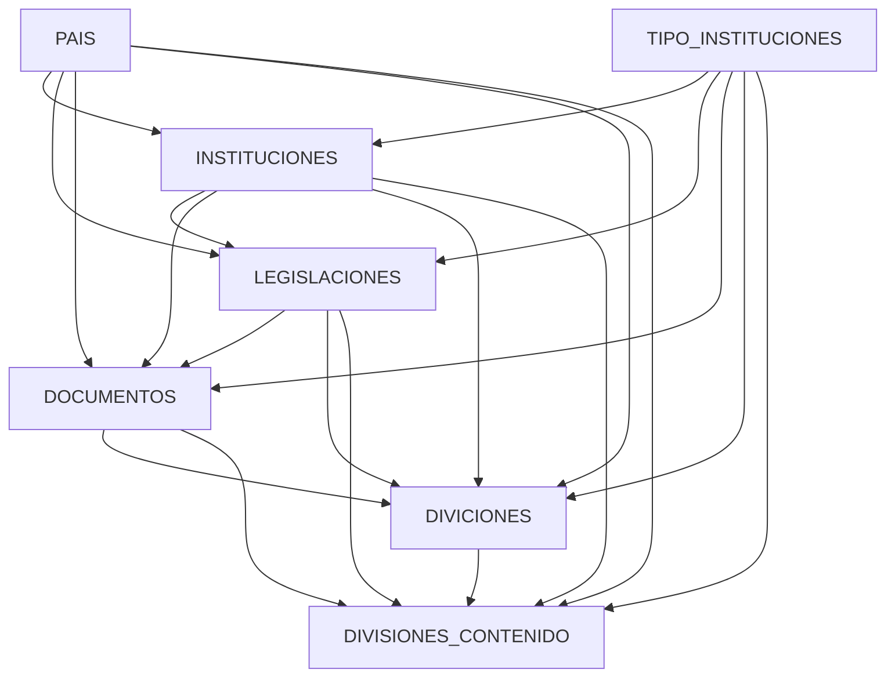
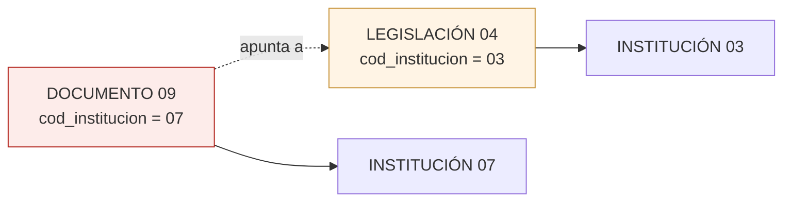
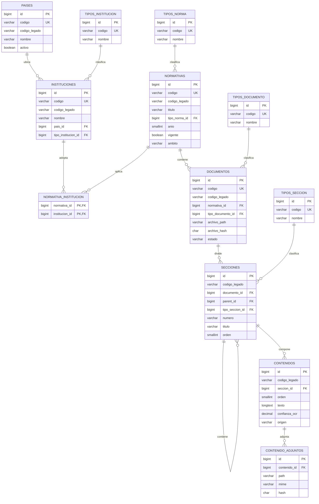
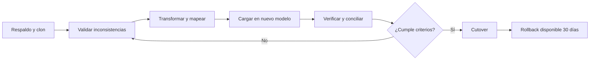
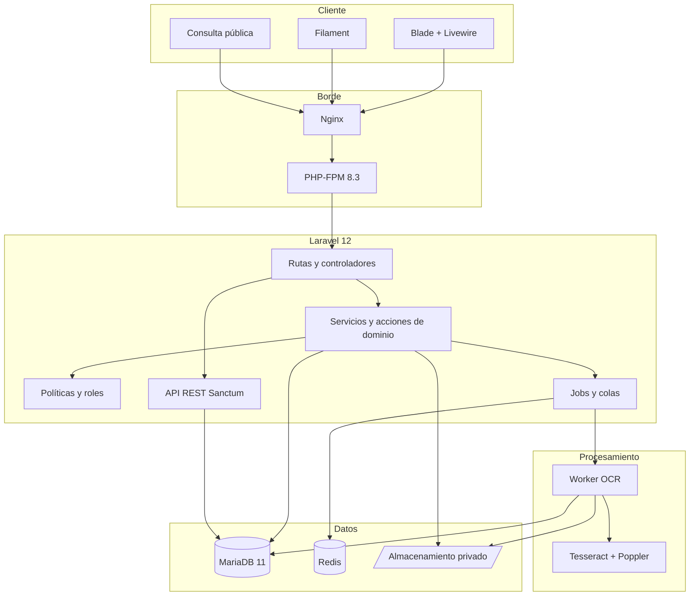
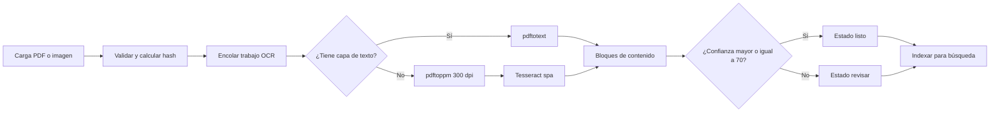
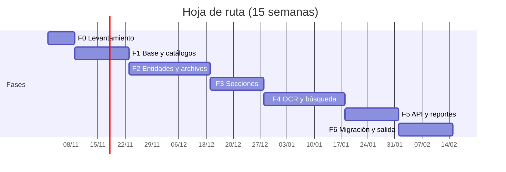

# Sistema de Registro de Marco Normativo de las Universidades Públicas

<p class="doc-meta"><strong>Planteamiento técnico y funcional</strong> · v1.0 · 25/10/2026<br>Documento base: <code>MODELOS DE DATOS RELACIONAL.docx</code></p>

## 1. Resumen ejecutivo

El documento original define un sistema PHP para administrar el marco normativo de las universidades públicas mediante siete tablas en MariaDB: `PAIS`, `TIPO_INSTITUCIONES`, `INSTITUCIONES`, `LEGISLACIONES`, `DOCUMENTOS`, `DIVICIONES` y `DIVISIONES_CONTENIDO`. La imagen incrustada en el documento (una página de un libro sobre arquitectura Transformer/LLM) confirma que el sistema no solo registrará metadatos: almacenará **documentos escaneados o PDF y su texto extraído**, por lo que el OCR y la búsqueda full-text son parte central del problema, no un añadido.

El diseño actual presenta una cadena de claves foráneas redundante que repite la ruta completa en cada nivel, incumple la tercera forma normal y permite inconsistencias que la base de datos no puede impedir. Además, los códigos primarios manuales de 2 y 4 caracteres se agotan, no distinguen el tipo de norma de la norma concreta y no representan la jerarquía real de un documento normativo.

Este planteamiento propone:

- Un **modelo normalizado en 3FN** con catálogos separados de entidades, un solo padre por tabla, relación muchos-a-muchos entre normativas e instituciones y jerarquía de secciones autorreferente.
- Un **sistema Laravel 12 + Blade/Livewire sobre MariaDB 11**, con panel administrativo, consulta pública, API REST, auditoría y respaldos.
- Un **pipeline de OCR asíncrono** con revisión humana y **búsqueda full-text** en español.
- Un **plan de migración** desde las siete tablas actuales con validación previa, mapeo de códigos legados y criterios de aceptación medibles.
- Una **hoja de ruta de 15 semanas** (rango 12–16) para un desarrollador.

> **Decisión clave:** se conserva la trazabilidad completa con el sistema anterior mediante `codigo_legado` y una vista que reconstruye la ruta `país → tipo → institución → normativa → documento → sección`, pero esa ruta deja de almacenarse.

---

## 2. Diagnóstico del documento original

### 2.1 Qué describe

El documento solicita un sistema en PHP para crear, actualizar, consultar y eliminar registros de siete tablas MariaDB. Cada tabla hija declara las claves foráneas de **todos sus ancestros**, no solo la de su padre inmediato.

La sección 7 del documento está vacía, y los ejemplos de registro presentan errores de formato: `022/10/2026` no es una fecha válida y el ejemplo de `DIVISIONES_CONTENIDO` ordena los códigos de forma distinta a la declaración de columnas.

### 2.2 La cadena de claves foráneas

<!-- diagrama:legacy -->



Cada tabla arrastra la ascendencia completa:

| Tabla | PK | FK declaradas | Códigos repetidos |
|---|---|---|---|
| `PAIS` | `cod_pais vc(4)` | — | 0 |
| `TIPO_INSTITUCIONES` | `cod_tipo vc(2)` | — | 0 |
| `INSTITUCIONES` | `cod_institucion vc(4)` | país, tipo | 2 |
| `LEGISLACIONES` | `cod_legislacion vc(2)` | país, tipo, institución | 3 |
| `DOCUMENTOS` | `cod_documento vc(4)` | país, tipo, institución, legislación | 4 |
| `DIVICIONES` | `cod_seccion vc(4)` | país, tipo, institución, legislación, documento | 5 |
| `DIVISIONES_CONTENIDO` | `cod_division vc(4)` | país, tipo, institución, legislación, documento, sección | 6 |

En total se almacenan **20 códigos de ascendencia** donde bastarían **6 referencias al padre inmediato**.

### 2.3 Los problemas, en detalle

#### a) Dependencia transitiva: se incumple la 3FN

En `DOCUMENTOS`, `cod_institucion` no depende de `cod_documento`: depende de `cod_legislacion`, que a su vez depende de `cod_documento`. La cadena es:

```
documento → legislación → institución → país / tipo
```

`DIVISIONES` arrastra cinco atributos derivados y `DIVISIONES_CONTENIDO`, seis. Son **datos derivados**, no información nueva: se pueden calcular recorriendo los padres. Almacenarlos crea redundancia y abre la puerta a contradicciones.

#### b) Claves foráneas independientes: la base acepta rutas imposibles

Cada código apunta a su tabla por separado, pero **nada obliga a que la ruta sea coherente**. MariaDB acepta sin error:

```
DOCUMENTO 09 → legislación 04 → institución 03
pero el mismo DOCUMENTO 09 tiene cod_institucion = 07
```

Para impedirlo harían falta claves únicas compuestas y claves foráneas compuestas en cada nivel, que el documento no define. Con claves foráneas simples, la coherencia depende de que el programador nunca se equivoque.

<!-- diagrama:anomalia -->



#### c) Anomalías de actualización y de borrado

- **Actualización:** si la legislación 04 cambia de institución (03 → 05), hay que actualizar a mano todos sus documentos, divisiones y contenidos. Una fila olvidada deja la norma visible bajo dos universidades.
- **Inserción:** para crear un contenido hay que conocer y escribir seis códigos; cada uno es una oportunidad de error.
- **Borrado:** al eliminar un padre, los hijos conservan una ruta que ya no existe. El documento no define `ON DELETE` ni `ON UPDATE`.

#### d) Problema de identidad: se guarda el tipo, no la norma

`LEGISLACIONES.DESCRIPCION = "Ley"` y `DOCUMENTOS.DESCRIPCION = "Estatuto"` son **categorías**, no normas concretas. Con una PK `vc(2)` solo caben 99 legislaciones y no se distingue *Ley 11 de 1981* de *Ley 47 de 1946*: ambas colisionarían en el mismo código. Lo mismo ocurre con `CAPITULO I`, que es una etiqueta de tipo de sección, no un capítulo identificable.

#### e) Cardinalidad incorrecta: una norma nacional pertenece a muchas universidades

Una ley nacional aplica a N universidades, pero `LEGISLACIONES` tiene **un solo** `cod_institucion`. El sistema se ve obligado a duplicar la ley por institución o a registrarla incompleta. El modelo mezcla la norma con la institución que la adopta.

#### f) Costo de crecer

Cada nivel nuevo (por ejemplo, "Artículo") obliga a un `ALTER TABLE` en todas las tablas y a repetir toda la ascendencia. El costo de almacenamiento e índices crece de forma casi cuadrática: el nivel 7 repite 6 códigos cuando solo necesita 1 padre. La jerarquía no se puede reconstruir con seguridad porque no existe la relación padre-hijo, solo una lista plana de ancestros.

### 2.4 Otras deficiencias detectadas

| Categoría | Hallazgo | Consecuencia |
|---|---|---|
| Primera forma normal | `CONTENIDO_BIN` guarda un arreglo (`[]` en el ejemplo) | Un campo con múltiples valores no es atómico |
| Tipos de dato | `CLOB` no existe en MariaDB; `CONTENIDO_TXT BLOB` se usa para texto | Búsqueda full-text inviable y comparaciones costosas |
| Longitudes | `TITULO vc(5)`; el ejemplo "Modelo Transforme" quedó truncado | Pérdida de información evidente en el propio ejemplo |
| Longitudes | `DESCRIPCION vc(100)` para títulos y descripciones | Truncamientos silenciosos |
| Claves | PK manuales `vc(2)`/`vc(4)` sin `AUTO_INCREMENT` ni formato | Colisiones, agotamiento y sin orden garantizado |
| Integridad | Sin `UNIQUE`, sin `CHECK`, sin `ON DELETE`/`ON UPDATE` | Duplicados y huérfanos |
| Auditoría | Solo `Fecha_registro` | No se sabe quién creó, modificó o eliminó |
| Seguridad | No hay usuarios, roles ni bitácora | Sin control de acceso ni trazabilidad |
| Nomenclatura | `DIVICIONES`, `TITILO`, `DESCRICPION`, `MariaBD`, mayúsculas mezcladas | Errores de implementación y mantenimiento |
| Archivos | Binarios dentro de la base de datos | Crecimiento del motor, respaldos pesados, sin versionado |
| Semántica | `LEGISLACIONES` y `DOCUMENTOS` son catálogos, no entidades | No se puede registrar el marco normativo real |

### 2.5 Impacto operativo

| Problema | Efecto en la universidad |
|---|---|
| Rutas incoherentes | Una norma aparece bajo la universidad equivocada en reportes oficiales |
| Duplicación de normas nacionales | Indicadores inflados y mantenimiento repetido |
| Sin OCR ni búsqueda | El corpus digital no es consultable; se depende de revisar PDF uno por uno |
| Sin auditoría | No se puede responder quién cambió una norma ni cuándo |
| Sin versionado de archivos | Se sobrescriben documentos y se pierde el histórico |
| Códigos de 2 y 4 caracteres | El sistema se agota al superar 99 tipos o 9 999 instituciones |

### 2.6 Conclusión del diagnóstico

El documento describe correctamente el **dominio** (un corpus normativo jerárquico con documentos y texto), pero su modelo de datos confunde **clasificación** con **entidad**, **ruta derivada** con **dato almacenado** y **tipo** con **instancia**. La corrección no consiste en agregar tablas, sino en **quitar la redundancia** y asignar a cada tabla un solo padre.

---

## 3. Alcance funcional

### 3.1 Objetivo

Disponer de un sistema institucional que permita registrar, clasificar, digitalizar, buscar y consultar el marco normativo de las universidades públicas, con trazabilidad de cambios y control de acceso, preparado para migrar los datos existentes y crecer sin rediseños.

### 3.2 Alcance de la versión 1

Incluye: catálogos maestros, instituciones, normativas, documentos y adjuntos, jerarquía de secciones, contenido con OCR, búsqueda full-text, usuarios y roles, auditoría, API REST, reportes, exportaciones y migración de datos.

No incluye: integración con LDAP/SSO, lectura de bases legacy institucionales, aplicación móvil, firma electrónica, flujo de aprobación editorial ni entrenamiento de modelos propios. El análisis asistido por LLM es opcional, requiere autorización institucional y se desactiva si no hay clave configurada.

### 3.3 Actores y roles

| Rol | Descripción | Permisos principales |
|---|---|---|
| Administrador | Responsable técnico del sistema | Todo, incluida gestión de usuarios, reproceso OCR y configuración |
| Catalogador | Personal de biblioteca o secretaría académica | Crear y editar instituciones, normativas, documentos, secciones y contenido; cargar archivos |
| Consulta | Usuario interno o público autorizado | Lectura, búsqueda y exportación |
| Sistema | Procesos automáticos | Jobs de OCR, generación de vistas y respaldos |

### 3.4 Módulos funcionales

| Módulo | Funcionalidades |
|---|---|
| **M1. Catálogos** | CRUD de países, tipos de institución, tipos de norma, tipos de documento y tipos de sección; activación lógica; importación CSV/Excel |
| **M2. Instituciones** | CRUD con país y tipo; siglas; estado activo; búsqueda y filtros |
| **M3. Normativas** | CRUD con tipo, número, año, fechas de publicación y vigencia, ente emisor, ámbito nacional/institucional y resumen; relación N:M con instituciones; control de vigencia |
| **M4. Documentos** | Carga de PDF/imagen, hash SHA-256, versión, detección de duplicados, metadatos, estado OCR y descarga controlada |
| **M5. Secciones** | Árbol de capítulos, artículos y numerales; ordenamiento; numeración; rango de páginas; movimiento entre nodos |
| **M6. Contenido** | Edición de bloques de texto, origen (PDF, OCR, manual), página y confianza OCR; adjuntos por bloque |
| **M7. OCR** | Procesamiento en cola, detección de capa de texto, reintentos, estados y bandeja de revisión |
| **M8. Búsqueda** | Full-text en español con filtros por institución, tipo, año, vigencia y documento; resaltado de coincidencias |
| **M9. Seguridad** | Autenticación, roles, políticas por recurso, bitácora de cambios y registro de accesos |
| **M10. API e informes** | API REST documentada, exportación PDF/CSV/JSON, dashboard de indicadores |
| **M11. Análisis con LLM** | Resumen estructurado, chat con fuentes, embeddings, control de coste y aviso de privacidad |

### 3.5 Casos de uso principales

| Código | Caso de uso | Actor | Resultado |
|---|---|---|---|
| UC-01 | Registrar una normativa nacional y asociarla a tres universidades | Catalogador | Una normativa, tres vínculos N:M, sin duplicar el registro |
| UC-02 | Cargar el estatuto orgánico de una universidad | Catalogador | Documento versionado, hash registrado y OCR en cola |
| UC-03 | Corregir el texto extraído de un artículo | Catalogador | Contenido con origen manual y auditoría del cambio |
| UC-04 | Buscar "consejo universitario" en una universidad y año | Consulta | Resultados ordenados por relevancia con resaltado |
| UC-05 | Revisar documentos con OCR de baja confianza | Administrador | Bandeja de revisión y reproceso |
| UC-06 | Exportar el articulado de una normativa a PDF | Consulta | PDF con jerarquía y numeración |
| UC-07 | Consultar quién modificó una sección | Administrador | Bitácora con usuario, fecha, valores anteriores y nuevos |

### 3.6 Requisitos funcionales

| ID | Requisito | Prioridad |
|---|---|---|
| RF-01 | CRUD de los cinco catálogos con validación y activación lógica | Must |
| RF-02 | CRUD de instituciones con país y tipo obligatorios | Must |
| RF-03 | CRUD de normativas con tipo, número, año y vigencia | Must |
| RF-04 | Relación muchos-a-muchos entre normativas e instituciones | Must |
| RF-05 | Carga de documentos con hash, versión y estado | Must |
| RF-06 | Árbol de secciones con profundidad ilimitada y orden | Must |
| RF-07 | Edición de contenido y adjuntos por sección | Must |
| RF-08 | OCR asíncrono con detección de capa de texto y reintentos | Must |
| RF-09 | Búsqueda full-text con filtros y resaltado | Must |
| RF-10 | Usuarios, roles y políticas de acceso | Must |
| RF-11 | Bitácora de auditoría de cambios | Must |
| RF-12 | Importación de catálogos desde CSV/Excel | Should |
| RF-13 | Exportación PDF, CSV y JSON | Should |
| RF-14 | API REST de consulta y escritura con tokens | Should |
| RF-15 | Dashboard de indicadores y pendientes | Should |
| RF-16 | Consulta pública de solo lectura | Could |
| RF-17 | Análisis con LLM: resumen estructurado y chat con fuentes | Should |

### 3.7 Requisitos no funcionales

| ID | Requisito | Meta |
|---|---|---|
| RNF-01 | Rendimiento de búsqueda | p95 < 1,5 s con 500 000 bloques de contenido |
| RNF-02 | Concurrencia | 50 usuarios simultáneos en horario laboral |
| RNF-03 | Disponibilidad | 99 % en horario laboral |
| RNF-04 | Seguridad | Controles OWASP Top 10 y hardening de servidor |
| RNF-05 | Accesibilidad | WCAG 2.1 nivel AA en las pantallas principales |
| RNF-06 | Respaldo | RPO 24 h, RTO 4 h |
| RNF-07 | Compatibilidad | Chrome, Edge y Firefox actuales; sin dependencia de plugins |
| RNF-08 | Idioma y codificación | Español, UTF-8 completo (`utf8mb4`) |
| RNF-09 | Trazabilidad | Toda modificación de entidades auditada |
| RNF-10 | Portabilidad | Despliegue reproducible con Docker Compose |

---

## 4. Modelo de datos normalizado

### 4.1 Reglas de normalización aplicadas

| Forma normal | Situación original | Corrección aplicada |
|---|---|---|
| **1FN** | `CONTENIDO_BIN` contiene un arreglo; un campo guarda varios binarios | Tabla `contenido_adjuntos`: una fila por archivo |
| **1FN** | Códigos de ancestros repetidos en cada fila | Se eliminan; cada fila tiene valores atómicos propios |
| **2FN** | La ruta completa se comporta como clave semántica y arrastra atributos parciales | PK sustituta `id`; tablas puente con PK compuesta solo de sus dos FK |
| **3FN** | `país`, `tipo` e `institución` dependen de `legislación`, no de `documento` | Solo se guarda el padre inmediato; la ruta se calcula |
| **3FN** | `nivel`, ruta y cantidad de hijos se almacenaban implícitamente | Se calculan con `JOIN` y CTE recursiva |
| **BCNF** | Un código de 2 caracteres identificaba a la vez el tipo y la instancia | Catálogo de tipos separado de la entidad real |

### 4.2 Diagrama entidad-relación

<!-- diagrama:er -->



### 4.3 Catálogos frente a entidades

La diferencia central es:

- **Catálogo:** lista cerrada de valores de clasificación (`Ley`, `Decreto`, `Estatuto`, `Capítulo`). Cambia poco y se referencia por `id`.
- **Entidad:** registro real y único (`Ley 11 de 1981`, `Estatuto Orgánico de la Universidad de Panamá`, `Capítulo I del documento 05`). Tiene identidad propia, archivo, fechas y auditoría.

El documento original usaba un solo código `vc(2)` para ambas cosas, lo que hacía imposible registrar dos leyes del mismo tipo o dos capítulos del mismo nombre.

### 4.4 Diccionario de datos

#### `paises`

| Campo | Tipo | Nulo | Restricción |
|---|---|---|---|
| `id` | BIGINT UNSIGNED | No | PK, AUTO_INCREMENT |
| `codigo` | VARCHAR(4) | No | UNIQUE, formato `[A-Z0-9]` |
| `codigo_legado` | VARCHAR(10) | Sí | Código del sistema anterior |
| `nombre` | VARCHAR(100) | No | — |
| `activo` | TINYINT(1) | No | Default 1 |
| `created_at`, `updated_at` | TIMESTAMP | No / Sí | Auditoría básica |

#### `tipos_institucion`, `tipos_norma`, `tipos_documento`, `tipos_seccion`

| Campo | Tipo | Nulo | Restricción |
|---|---|---|---|
| `id` | BIGINT UNSIGNED | No | PK |
| `codigo` | VARCHAR(2) | No | UNIQUE |

> `tipos_seccion` usa códigos de tres letras (`DOC`, `TIT`, `CAP`, `SEC`, `ART`),
> por lo que su columna `codigo` es `VARCHAR(5)`.
| `codigo_legado` | VARCHAR(10) | Sí | Trazabilidad |
| `nombre` | VARCHAR(100) | No | UNIQUE por catálogo |
| `activo` | TINYINT(1) | No | Default 1 |

#### `instituciones`

| Campo | Tipo | Nulo | Restricción |
|---|---|---|---|
| `id` | BIGINT UNSIGNED | No | PK |
| `codigo` | VARCHAR(20) | No | UNIQUE, formato `PA-PU-0001` |
| `codigo_legado` | VARCHAR(10) | Sí | UNIQUE |
| `nombre` | VARCHAR(150) | No | — |
| `siglas` | VARCHAR(30) | Sí | — |
| `pais_id` | BIGINT UNSIGNED | No | FK → `paises.id`, RESTRICT |
| `tipo_institucion_id` | BIGINT UNSIGNED | No | FK → `tipos_institucion.id`, RESTRICT |
| `activo` | TINYINT(1) | No | Default 1 |
| `created_at`, `updated_at`, `deleted_at` | TIMESTAMP | — | Auditoría y baja lógica |

#### `normativas`

| Campo | Tipo | Nulo | Restricción |
|---|---|---|---|
| `id` | BIGINT UNSIGNED | No | PK |
| `codigo` | VARCHAR(30) | No | UNIQUE, formato `PA-LEY-1981-0001` |
| `codigo_legado` | VARCHAR(10) | Sí | UNIQUE |
| `titulo` | VARCHAR(255) | No | FULLTEXT |
| `tipo_norma_id` | BIGINT UNSIGNED | No | FK → `tipos_norma.id`, RESTRICT |
| `numero` | VARCHAR(50) | Sí | — |
| `anio` | SMALLINT UNSIGNED | Sí | CHECK 1800–2100 |
| `fecha_publicacion` | DATE | Sí | — |
| `fecha_vigencia` | DATE | Sí | — |
| `vigente` | TINYINT(1) | No | Default 1 |
| `ambito` | VARCHAR(15) | No | CHECK `nacional` / `institucional` |
| `ente_emisor` | VARCHAR(150) | Sí | — |
| `resumen` | TEXT | Sí | — |
| `created_at`, `updated_at`, `deleted_at` | TIMESTAMP | — | Auditoría y baja lógica |

#### `normativa_institucion`

| Campo | Tipo | Nulo | Restricción |
|---|---|---|---|
| `normativa_id` | BIGINT UNSIGNED | No | PK compuesta, FK CASCADE |
| `institucion_id` | BIGINT UNSIGNED | No | PK compuesta, FK CASCADE |
| `created_at` | TIMESTAMP | No | — |

#### `documentos`

| Campo | Tipo | Nulo | Restricción |
|---|---|---|---|
| `id` | BIGINT UNSIGNED | No | PK |
| `codigo` | VARCHAR(40) | No | UNIQUE |
| `codigo_legado` | VARCHAR(10) | Sí | UNIQUE |
| `normativa_id` | BIGINT UNSIGNED | No | FK → `normativas.id`, CASCADE |
| `tipo_documento_id` | BIGINT UNSIGNED | No | FK → `tipos_documento.id`, RESTRICT |
| `titulo` | VARCHAR(255) | No | — |
| `archivo_path` | VARCHAR(500) | Sí | Ruta privada; nulo si no hay digitalización |
| `archivo_hash` | CHAR(64) | Sí | SHA-256, índice para deduplicación |
| `archivo_mime` | VARCHAR(100) | Sí | — |
| `archivo_tamano` | BIGINT UNSIGNED | Sí | Bytes |
| `paginas` | SMALLINT UNSIGNED | Sí | — |
| `version` | SMALLINT UNSIGNED | No | Default 1 |
| `estado` | VARCHAR(15) | No | CHECK `sin_archivo`, `pendiente`, `en_cola`, `procesando`, `listo`, `revisar`, `error` |
| `ocr_error` | TEXT | Sí | Detalle del último fallo |
| `created_at`, `updated_at`, `deleted_at` | TIMESTAMP | — | Auditoría y baja lógica |

#### `secciones`

| Campo | Tipo | Nulo | Restricción |
|---|---|---|---|
| `id` | BIGINT UNSIGNED | No | PK |
| `codigo_legado` | VARCHAR(10) | Sí | Código del sistema anterior |
| `documento_id` | BIGINT UNSIGNED | No | FK → `documentos.id`, CASCADE |
| `parent_id` | BIGINT UNSIGNED | Sí | FK → `secciones.id`, CASCADE |
| `tipo_seccion_id` | BIGINT UNSIGNED | No | FK → `tipos_seccion.id`, RESTRICT |
| `numero` | VARCHAR(50) | Sí | — |
| `titulo` | VARCHAR(255) | No | — |
| `orden` | SMALLINT UNSIGNED | No | Default 0 |
| `pagina_inicio` | SMALLINT UNSIGNED | Sí | — |
| `pagina_fin` | SMALLINT UNSIGNED | Sí | CHECK fin ≥ inicio |
| `created_at`, `updated_at` | TIMESTAMP | — | — |

#### `contenidos`

| Campo | Tipo | Nulo | Restricción |
|---|---|---|---|
| `id` | BIGINT UNSIGNED | No | PK |
| `codigo_legado` | VARCHAR(10) | Sí | Código del sistema anterior |
| `seccion_id` | BIGINT UNSIGNED | No | FK → `secciones.id`, CASCADE |
| `orden` | SMALLINT UNSIGNED | No | Default 0 |
| `texto` | LONGTEXT | No | Texto original |
| `texto_normalizado` | LONGTEXT | Sí | Minúsculas sin acentos, índice FULLTEXT |
| `pagina` | SMALLINT UNSIGNED | Sí | — |
| `origen` | VARCHAR(10) | No | CHECK `pdf`, `ocr`, `manual` |
| `confianza_ocr` | DECIMAL(5,2) | Sí | CHECK 0–100 |
| `created_at`, `updated_at` | TIMESTAMP | — | — |

#### `contenido_adjuntos`

| Campo | Tipo | Nulo | Restricción |
|---|---|---|---|
| `id` | BIGINT UNSIGNED | No | PK |
| `contenido_id` | BIGINT UNSIGNED | No | FK → `contenidos.id`, CASCADE |
| `path` | VARCHAR(500) | No | — |
| `mime` | VARCHAR(100) | No | — |
| `tamano` | BIGINT UNSIGNED | No | — |
| `hash` | CHAR(64) | No | SHA-256 |
| `created_at` | TIMESTAMP | No | — |

#### `migracion_map`

| Campo | Tipo | Nulo | Restricción |
|---|---|---|---|
| `tabla_origen` | VARCHAR(50) | No | PK compuesta |
| `codigo_origen` | VARCHAR(20) | No | PK compuesta |
| `tabla_destino` | VARCHAR(50) | No | — |
| `id_destino` | BIGINT UNSIGNED | No | — |

Las tablas `users`, `roles`, `permissions`, `model_has_roles` y `audits` las generan Laravel, Spatie y `owen-it/laravel-auditing` con sus propias migraciones.

### 4.5 Integridad referencial y reglas de borrado

| Relación | Regla | Motivo |
|---|---|---|
| Catálogos → entidades | `ON DELETE RESTRICT` | No eliminar un país o tipo en uso |
| `instituciones` → `normativa_institucion` | `ON DELETE CASCADE` | El vínculo muere con la institución |
| `normativas` → `documentos` | `ON DELETE CASCADE` | El documento pertenece a la normativa |
| `documentos` → `secciones` | `ON DELETE CASCADE` | La estructura muere con el documento |
| `secciones` → `secciones` | `ON DELETE CASCADE` | Subárbol completo |
| `secciones` → `contenidos` | `ON DELETE CASCADE` | El contenido pertenece a la sección |
| `contenidos` → `contenido_adjuntos` | `ON DELETE CASCADE` | El adjunto pertenece al bloque |
| Entidades principales | Baja lógica (`deleted_at`) | Preservar historial y auditoría |

Con claves sustitutas, los identificadores nunca cambian; por eso no se usa `ON UPDATE CASCADE`.

### 4.6 Índices y búsqueda

- Índice en **todas** las claves foráneas.
- `UNIQUE` en `codigo` y `codigo_legado` de cada entidad.
- Índices compuestos: `(documento_id, parent_id, orden)`, `(anio, vigente)`, `(estado)`.
- `archivo_hash` indexado para detectar duplicados y versiones.
- `FULLTEXT` sobre `contenidos.texto_normalizado` y `normativas.titulo`.

La búsqueda se hace con `MATCH ... AGAINST (... IN BOOLEAN MODE)` y puntaje de relevancia, combinada con filtros relacionales. `texto_normalizado` se genera en la aplicación al guardar (minúsculas, sin acentos, espacios colapsados), de modo que la búsqueda sea insensible a tildes y mayúsculas sin depender de la colación del índice.

> **Umbral mínimo:** MariaDB ignora por defecto palabras de menos de 3 caracteres (`innodb_ft_min_token_size`). Debe documentarse porque afecta búsquedas como "ley".

### 4.7 Vistas de compatibilidad

La ruta completa del sistema anterior se reconstruye con una vista, sin almacenarla:

```sql
CREATE OR REPLACE VIEW vista_contenido_ruta AS
SELECT
    c.id              AS contenido_id,
    p.codigo          AS pais_codigo,
    ti.codigo         AS tipo_institucion_codigo,
    i.codigo          AS institucion_codigo,
    n.codigo          AS normativa_codigo,
    d.codigo          AS documento_codigo,
    s.id              AS seccion_id,
    s.titulo          AS seccion_titulo,
    c.texto
FROM contenidos c
JOIN secciones s              ON s.id = c.seccion_id
JOIN documentos d             ON d.id = s.documento_id
JOIN normativas n             ON n.id = d.normativa_id
JOIN normativa_institucion ni ON ni.normativa_id = n.id
JOIN instituciones i          ON i.id = ni.institucion_id
JOIN paises p                 ON p.id = i.pais_id
JOIN tipos_institucion ti     ON ti.id = i.tipo_institucion_id;
```

Una normativa compartida aparecerá una vez por institución: es el comportamiento correcto de una relación N:M, no una duplicación de datos.

El árbol se reconstruye con una CTE recursiva:

```sql
WITH RECURSIVE arbol AS (
    SELECT s.id, s.documento_id, s.parent_id, s.titulo, s.orden,
           1 AS nivel,
           LPAD(s.orden, 4, '0') AS ruta
    FROM secciones s
    WHERE s.documento_id = ? AND s.parent_id IS NULL
    UNION ALL
    SELECT h.id, h.documento_id, h.parent_id, h.titulo, h.orden,
           a.nivel + 1,
           CONCAT(a.ruta, '.', LPAD(h.orden, 4, '0'))
    FROM secciones h
    JOIN arbol a ON h.parent_id = a.id
)
SELECT * FROM arbol ORDER BY ruta;
```

### 4.8 Comparación: documento original frente a diseño propuesto

| Aspecto | Documento original | Diseño propuesto |
|---|---|---|
| Claves foráneas por tabla | Toda la ascendencia (2 a 6) | Solo el padre inmediato (1 a 2) |
| Coherencia de la ruta | No garantizada por la base | Imposible de romper por construcción |
| Tipo frente a instancia | Un código para "Ley" y para la ley real | `tipos_norma` separado de `normativas` |
| Jerarquía | Fija en columnas; un nivel = un `ALTER TABLE` | `parent_id`: profundidad ilimitada sin cambiar esquema |
| Norma compartida | Duplicada por institución | Tabla puente `normativa_institucion` |
| Actualización de ancestros | Manual en N descendientes | Un `UPDATE` en la fila padre |
| Borrado | Hijos huérfanos | `RESTRICT` en entidades, `CASCADE` en composición |
| Datos derivados | Almacenados y repetidos | Calculados en vistas y CTE |
| Normalización | 1FN y 3FN incumplidas | 1FN, 2FN, 3FN y BCNF |
| Binarios | BLOB/CLOB en la base | Archivos en almacenamiento + metadatos en tabla |
| Búsqueda | No prevista | FULLTEXT con texto normalizado |

### 4.9 El mismo registro en ambos modelos

**Original:** una sola fila con la secuencia `01, 02, 03, 04, 05, 06`.

**Propuesto:** siete entidades relacionadas por su padre inmediato.

```
país 01
tipo_institucion 02
institución 03          → pais_id = 01, tipo_institucion_id = 02
normativa 04            → tipo_norma = "Ley", número 11, año 1981
normativa_institucion   → (04, 03)
documento 05            → normativa_id = 04, tipo_documento = "Estatuto"
sección 06              → documento_id = 05, tipo_seccion = "Capítulo", número "I"
contenido 07            → seccion_id = 06, orden 1, texto …
```

La ruta `01 → 02 → 03 → 04 → 05 → 06` ya no se guarda: se reconstruye con `JOIN`. No se pierde nada, porque `vista_contenido_ruta` puede exportar exactamente los seis códigos para reportes o para convivencia con el sistema anterior, y los códigos viejos se conservan en `codigo_legado`.

### 4.10 Convenciones de datos

| Elemento | Convención |
|---|---|
| Tablas | `snake_case`, plural, en español: `normativas`, `documentos` |
| Columnas | `snake_case`, singular: `pais_id`, `fecha_publicacion` |
| Claves | `id` sustituta; `codigo` legible; `codigo_legado` para migración |
| Booleanos | `TINYINT(1)`, prefijo `es_` o `activo`/`vigente` |
| Fechas | `DATE` para hechos, `TIMESTAMP` para auditoría |
| Textos | `VARCHAR` con longitud justificada; `TEXT`/`LONGTEXT` para contenido |
| Dinero y porcentajes | `DECIMAL`, nunca `FLOAT` |
| Codificación | `utf8mb4`; colación `utf8mb4_uca1400_ai_ci` (MariaDB 11.4+) o `utf8mb4_unicode_ci` |
| Estados | `VARCHAR` corto con `CHECK`, mapeado a un `enum` de PHP |
| Nombres de FK | `<tabla_singular>_id` |
| Nombres de índices | `idx_`, `uq_`, `ft_` |
| Formatos de código | `PA-PU-0001` instituciones; `PA-LEY-1981-0001` normativas; sufijo `-D01` documentos |

Los formatos se validan en la aplicación con expresiones regulares y, además, con `CHECK` de longitud en la base para evitar valores absurdos.

---

## 5. Plan de migración de datos

### 5.1 Estrategia

1. **Respaldo y clonación.** Copia completa del sistema actual y de sus archivos; la migración se ensaya sobre una réplica, nunca sobre producción.
2. **Validación previa.** Ejecutar controles de calidad y generar un reporte de inconsistencias antes de transformar.
3. **Catálogos primero.** Crear países, tipos y su mapa de códigos legados.
4. **Entidades después.** Instituciones, normativas, vínculos, documentos, secciones y contenidos en orden jerárquico.
5. **Idempotencia.** Cada comando de carga puede repetirse sin duplicar filas, usando `migracion_map`.
6. **Verificación.** Conciliación de conteos, integridad referencial y muestreo funcional.
7. **Cutover.** Ventana de mantenimiento con congelamiento de escrituras, carga final y rollback documentado.

<!-- diagrama:migracion -->



### 5.2 Mapeo de tablas

| Origen | Destino | Transformación |
|---|---|---|
| `PAIS` | `paises` | `codigo_legado = cod_pais`; `nombre = descripcion` |
| `TIPO_INSTITUCIONES` | `tipos_institucion` | `codigo_legado = cod_tipo`; normalizar descripción |
| `INSTITUCIONES` | `instituciones` | Resolver `pais_id` y `tipo_institucion_id` por mapa |
| `LEGISLACIONES` | `tipos_norma` + `normativas` + `normativa_institucion` | Un tipo por descripción distinta; una normativa por código; vínculo con su institución |
| `DOCUMENTOS` | `tipos_documento` + `documentos` | Un tipo por descripción distinta; una fila por código; `estado = sin_archivo` si no hay PDF |
| `DIVICIONES` | `tipos_seccion` + `secciones` | Un tipo por patrón de descripción; jerarquía inferida por numeración |
| `DIVISIONES_CONTENIDO` | `contenidos` + `contenido_adjuntos` | `CONTENIDO_TXT` → `texto`; `CONTENIDO_BIN` → archivo; separar arreglos |
| — | `migracion_map` | Correspondencia código legado → `id` nuevo |

> **Ambigüedad crítica del origen:** `LEGISLACIONES` usa PK `vc(2)` y descripciones como "Ley", lo que sugiere un catálogo de tipos más que un registro de leyes concretas. El levantamiento debe confirmar la semántica antes de cargar: si esas filas son tipos, se migran a `tipos_norma` y **no se inventan normativas**; si son normas, se migran a `normativas` conservando el código legado. La misma validación aplica a `DOCUMENTOS` ("Estatuto") y `DIVICIONES` ("CAPITULO I"). Esta decisión condiciona el volumen real del corpus y debe quedar por escrito.

### 5.3 Reglas de transformación y validaciones

- **Semántica del catálogo:** clasificar cada fila de `LEGISLACIONES`, `DOCUMENTOS` y `DIVICIONES` como tipo o como instancia antes de transformar. Mezclar ambas interpretaciones produce normas ficticias o tipos duplicados.

- **Códigos duplicados:** detectar y detener la carga; no se permite ambigüedad.
- **Huérfanos:** todo hijo debe tener padre existente. Se reportan y se excluyen hasta su corrección.
- **Rutas incoherentes:** comparar país, tipo e institución entre cada hijo y su ancestro.
- **Fechas inválidas:** `022/10/2026` y similares se marcan para corrección manual; no se inventan fechas.
- **Títulos truncados:** valores con longitud 5 en `TITULO` se marcan como sospechosos de truncamiento.
- **Descripciones repetidas:** se consolidan en catálogos; se conserva la variante más completa.
- **Arreglos binarios:** el valor `[]` o listas con varios archivos se convierten en filas de `contenido_adjuntos`.
- **Jerarquía ausente:** si no se puede inferir el padre, las secciones se cargan planas bajo el documento y entran a una cola de revisión.
- **Documentos sin archivo:** se cargan con `archivo_path = NULL` y estado `sin_archivo`; se listan para digitalización.

Consultas de control de ejemplo:

```sql
SELECT 'documento_institución_incoherente' AS control, COUNT(*) AS filas
FROM DOCUMENTOS d
JOIN LEGISLACIONES l ON l.COD_LEGISLACION = d.COD_LEGISLACION
WHERE d.COD_INSTITUCION <> l.COD_INSTITUCION
UNION ALL
SELECT 'documento_pais_incoherente', COUNT(*)
FROM DOCUMENTOS d
JOIN LEGISLACIONES l ON l.COD_LEGISLACION = d.COD_LEGISLACION
WHERE d.COD_PAIS <> l.COD_PAIS
UNION ALL
SELECT 'seccion_sin_documento', COUNT(*)
FROM DIVICIONES v
LEFT JOIN DOCUMENTOS d ON d.COD_DOCUMENTO = v.COD_DOCUMENTO
WHERE d.COD_DOCUMENTO IS NULL;
```

### 5.4 Tabla de mapeo

`migracion_map` guarda la correspondencia `(tabla_origen, codigo_origen) → id_destino`. Esto permite:

- Reejecutar la carga sin duplicar.
- Trazar cualquier registro nuevo hasta su origen.
- Resolver referencias durante la transformación sin adivinar.
- Generar un reporte de cobertura de la migración.

### 5.5 Criterios de aceptación de la migración

| Criterio | Meta |
|---|---|
| Conteo de registros | 100 % conciliado o diferencia justificada por escrito |
| Huérfanos | 0 |
| Rutas incoherentes | 0 |
| Códigos duplicados | 0 |
| Fechas inválidas | 100 % corregidas o marcadas |
| Registros en revisión manual | < 0,5 % del total |
| Búsqueda de muestra | 20 consultas de validación con resultados correctos |
| Documentos sin archivo | Inventario entregado con responsable y fecha |

### 5.6 Cutover y rollback

1. Congelar escrituras en el sistema anterior.
2. Exportar el delta final.
3. Ejecutar validación, carga y verificación.
4. Cambiar el acceso al nuevo sistema.
5. Mantener el anterior en solo lectura durante 30 días.
6. Rollback: restaurar respaldo, reactivar el anterior y documentar la causa.

---

## 6. Arquitectura técnica

### 6.1 Decisiones de stack

| Componente | Elección | Justificación |
|---|---|---|
| Lenguaje | PHP 8.3 | Requisito del entorno laboral; tipado estricto, `readonly`, enums |
| Framework | Laravel 12 | Velocidad de entrega, migraciones, colas, auth, políticas y ecosistema |
| UI administrativa | Filament 5 | CRUD y relaciones en días, con menos código propio |
| UI pública | Blade + Livewire | Interactividad sin salir de PHP; una sola base de conocimiento |
| Base de datos | MariaDB 11 | Compatibilidad con el entorno y `FULLTEXT`, `CHECK` y CTE |
| Caché y colas | Redis + Horizon | OCR y tareas pesadas fuera de la petición web |
| Autenticación | Laravel Fortify | Login, recuperación y segundo factor opcional |
| Roles | `spatie/laravel-permission` | Estándar probado, matriz de permisos clara |
| Auditoría | `owen-it/laravel-auditing` | Registro automático de cambios por modelo |
| API | Laravel Sanctum + OpenAPI | Tokens por rol y documentación generada |
| OCR | Tesseract + Poppler | Sin costo de licencia; reemplazable por servicio en la nube |
| Pruebas | Pest + Larastan + Pint | Cobertura de servicios críticos y estilo uniforme |
| Despliegue | Docker Compose | Reproducible en desarrollo, pruebas y producción |

### 6.2 Arquitectura de la solución

<!-- diagrama:arquitectura -->



### 6.3 Capas y estructura del proyecto

```
app/
├── Actions/            Operaciones de dominio atómicas
├── Enums/              Estados, ámbitos y orígenes
├── Filament/           Recursos y páginas del panel
├── Http/
│   ├── Controllers/    Controladores delgados
│   ├── Requests/       Validación
│   └── Resources/      Respuestas de API
├── Jobs/               OCR y tareas asíncronas
├── Livewire/           Componentes de consulta y edición
├── Models/             Eloquent con relaciones y scopes
├── Policies/           Autorización por recurso
├── Services/           OCR, búsqueda, exportación, migración
└── Support/            Utilidades: normalización de texto, códigos
```

Regla de diseño: el controlador no contiene lógica de negocio; valida, delega en un servicio o acción y devuelve una respuesta. La lógica de OCR, búsqueda y migración vive en servicios probados de forma aislada.

### 6.4 Modelo de dominio en Eloquent

| Modelo | Relaciones |
|---|---|
| `Pais` | `hasMany(Institucion)` |
| `TipoInstitucion` | `hasMany(Institucion)` |
| `Institucion` | `belongsTo(Pais)`, `belongsTo(TipoInstitucion)`, `belongsToMany(Normativa)` |
| `TipoNorma` | `hasMany(Normativa)` |
| `Normativa` | `belongsTo(TipoNorma)`, `belongsToMany(Institucion)`, `hasMany(Documento)` |
| `TipoDocumento` | `hasMany(Documento)` |
| `Documento` | `belongsTo(Normativa)`, `belongsTo(TipoDocumento)`, `hasMany(Seccion)` |
| `Seccion` | `belongsTo(Documento)`, `belongsTo(Seccion, 'parent_id')`, `hasMany(Seccion, 'parent_id')`, `belongsTo(TipoSeccion)`, `hasMany(Contenido)` |
| `Contenido` | `belongsTo(Seccion)`, `hasMany(ContenidoAdjunto)` |

### 6.5 Almacenamiento de archivos

- Ruta base: `storage/app/privado/documentos/{pais}/{institucion}/{anio}/{uuid}.pdf`.
- Nombre original, MIME, tamaño y hash en la tabla; el archivo nunca se sirve directamente por URL.
- Descarga mediante controlador con política de autorización.
- SHA-256 para detectar duplicados y cambios de versión.
- Versionado: una nueva carga del mismo tipo de documento incrementa `version` y conserva el anterior.
- Respaldo del directorio junto con la base de datos.
- Límite de tamaño configurable (por ejemplo, 100 MB) y validación por MIME real, no por extensión.
- Escaneo antivirus opcional con ClamAV antes de mover el archivo a su ruta definitiva.

### 6.6 Pipeline de OCR

<!-- diagrama:ocr -->



Estados del documento: `sin_archivo → pendiente → en_cola → procesando → listo | revisar | error`.

Reglas del proceso:

- Si el PDF ya tiene texto, se extrae sin OCR y se marca `origen = pdf`.
- Si es escaneado, se renderiza a 300 dpi y se procesa con Tesseract en español.
- La confianza se calcula por página; por debajo de 70 pasa a revisión humana.
- Tres intentos con retroceso exponencial; luego `error` con mensaje almacenado.
- Reproceso solo por administrador, con confirmación y borrado previo de bloques generados por OCR.
- Un trabajo por documento, en cola dedicada `ocr`, con timeout ampliado y memoria controlada.

### 6.7 Búsqueda

1. Al guardar un contenido se genera `texto_normalizado`.
2. El índice `FULLTEXT` cubre ese campo.
3. La consulta usa modo booleano y combina relevancia con filtros relacionales.
4. Se devuelve un fragmento con resaltado de coincidencias.
5. Se registran las búsquedas sin resultados para mejorar el corpus y detectar faltantes.

Si el corpus supera el millón de bloques o se requiere tolerancia a errores tipográficos, la evolución prevista es Meilisearch o Typesense, sin cambiar el modelo de datos.

### 6.8 Colas y trabajos

| Trabajo | Cola | Función |
|---|---|---|
| `ProcesarDocumentoOcr` | `ocr` | Extraer, reconocer y crear bloques |
| `ReindexarContenido` | `default` | Recalcular texto normalizado |
| `GenerarExportacion` | `default` | PDF/CSV de grandes volúmenes |
| `NotificarRevision` | `default` | Aviso de documentos con baja confianza |
| `RespaldarMetadatos` | `default` | Inventario periódico |

Horizon supervisa workers, reintentos y fallos. Las colas fallidas se revisan semanalmente.

### 6.9 API REST

| Método | Ruta | Descripción |
|---|---|---|
| GET | `/api/v1/paises` | Lista catálogo |
| GET | `/api/v1/instituciones` | Lista con filtros |
| GET | `/api/v1/instituciones/{codigo}` | Detalle con normativas |
| GET | `/api/v1/normativas` | Lista con filtros |
| GET | `/api/v1/normativas/{codigo}` | Detalle, documentos y vínculos |
| GET | `/api/v1/documentos/{codigo}` | Metadatos y estado OCR |
| GET | `/api/v1/documentos/{codigo}/secciones` | Árbol de secciones |
| GET | `/api/v1/buscar?q=` | Búsqueda full-text |
| POST | `/api/v1/normativas` | Crear (rol catalogador) |
| PUT | `/api/v1/normativas/{codigo}` | Actualizar (rol catalogador) |
| DELETE | `/api/v1/normativas/{codigo}` | Baja lógica (administrador) |
| GET | `/api/v1/estadisticas` | Indicadores del dashboard |

La documentación OpenAPI se genera y publica en `/api/documentacion`. Los tokens se emiten por usuario y heredan su rol; toda escritura queda auditada.

### 6.10 Reportes y exportaciones

- **PDF:** normativa completa con jerarquía, numeración y pies de página.
- **CSV/Excel:** catálogos, inventario de documentos, resultados de búsqueda.
- **JSON:** integración con otros sistemas y respaldo de metadatos.
- **Dashboard:** normativas por institución, documentos por estado OCR, cobertura por tipo, pendientes de revisión y búsquedas sin resultado.

### 6.11 Puntos de extensión previstos

Aunque la versión 1 no integra sistemas externos, la arquitectura deja preparados:

- Proveedor de identidad (LDAP/Active Directory o SAML/OIDC) mediante un servicio de autenticación desacoplado.
- Conectores de lectura a bases legacy a través de servicios de consulta, nunca con acceso directo desde los controladores.
- Almacenamiento compatible con S3/MinIO sustituyendo el disco local.
- Proveedor de OCR externo implementando la misma interfaz que el motor local.
- Proveedor de LLM configurable (OpenAI, Ollama local o endpoint institucional) mediante la interfaz `ClienteLlm`.

---

## 7. Seguridad y auditoría

### 7.1 Autenticación

- Contraseñas con Argon2id y mínimo de 12 caracteres.
- Bloqueo temporal tras intentos fallidos y limitación de tasa en el login.
- Sesiones con cookies `Secure`, `HttpOnly` y `SameSite=Lax`.
- Segundo factor opcional para administradores.
- Cierre de sesión por inactividad configurable.

### 7.2 Autorización

| Funcionalidad | Administrador | Catalogador | Consulta |
|---|---|---|---|
| Catálogos | Crear, editar, eliminar | Leer | Leer |
| Instituciones | Crear, editar, eliminar | Crear, editar | Leer |
| Normativas | Crear, editar, eliminar | Crear, editar | Leer |
| Documentos | Cargar, versionar, eliminar | Cargar, versionar | Leer |
| Secciones y contenido | Todo | Crear, editar | Leer |
| OCR | Reprocesar, configurar | Ver estado | No |
| Usuarios y roles | Todo | No | No |
| Auditoría | Ver todo | Ver propia | No |
| API | Todos los alcances | Lectura y escritura | Lectura |
| Exportaciones | Todas | Todas | Todas |

Toda regla se implementa con políticas de Laravel, no con condicionales dispersos en las vistas.

### 7.3 Auditoría

- Se auditan instituciones, normativas, documentos, secciones, contenidos y usuarios.
- Se registra usuario, fecha, dirección IP, evento y valores anterior y nuevo.
- Los cambios de archivo registran hash y versión.
- La bitácora es de solo lectura y se conserva al menos cinco años.

### 7.4 Endurecimiento web

- Protección CSRF en formularios y sesiones.
- Escape automático de salida en Blade contra XSS.
- Consultas parametrizadas mediante Eloquent/PDO.
- Cabeceras: HSTS, `X-Content-Type-Options`, `X-Frame-Options`, `Referrer-Policy`, `Content-Security-Policy`.
- Validación de entrada con Form Requests y reglas explícitas.
- Registro de eventos de seguridad y alertas de accesos anómalos.

### 7.5 Manejo de archivos

- Validación de MIME real y extensión permitida.
- Límite de tamaño y de páginas.
- Almacenamiento fuera del directorio público.
- Nombres aleatorios; nunca se usa el nombre original como ruta.
- Escaneo antivirus opcional.
- Descarga autenticada y auditada.

### 7.6 Respaldos y recuperación

| Elemento | Frecuencia | Retención |
|---|---|---|
| Base de datos | Diaria | 30 diarias, 12 mensuales |
| Archivos | Diaria incremental | 30 diarias, 12 mensuales |
| Configuración y secretos | Por cambio | Histórico en gestor de secretos |
| Prueba de restauración | Trimestral | Acta firmada |

Objetivos: RPO 24 horas, RTO 4 horas. Los respaldos se almacenan en un medio distinto al servidor de producción.

### 7.7 Datos personales

El sistema está orientado a documentos institucionales; no debe almacenar datos personales sensibles. Los usuarios se limitan a cuentas institucionales y la información mínima necesaria. Cualquier tratamiento adicional requiere revisión de la política de protección de datos de la universidad.

---

## 8. Estándares y convenciones

### 8.1 Código

- PHP 8.3 con `declare(strict_types=1)` en todos los archivos.
- PSR-12 y Laravel Pint en cada commit.
- Larastan nivel 6 como mínimo.
- Pest para pruebas; cobertura mínima del 70 % en servicios críticos (OCR, búsqueda, migración, autorización).
- Sin lógica de negocio en controladores ni en modelos: servicios y acciones.
- Enums de PHP para estados, ámbitos y orígenes.
- Nombres de dominio en español (`Normativa`, `Documento`, `Seccion`); infraestructura en inglés (`Controller`, `Request`, `Job`).

### 8.2 Base de datos

- Migraciones versionadas; prohibido modificar producción a mano.
- Seeders solo para catálogos y datos de demostración.
- Toda migración debe incluir `down()` funcional.
- Nombres de índices y restricciones explícitos.
- Prohibido `SELECT *` en consultas de aplicación.
- Paginación obligatoria en listados; sin cargas completas de tablas.

### 8.3 Git y entrega

- Ramas: `main` protegida, `feature/*`, `fix/*`.
- Commits con Conventional Commits.
- Revisión por pares obligatoria antes de integrar.
- Integración continua: Pint, Larastan y Pest en cada push.
- Etiquetas de versión y registro de cambios por entrega.

### 8.4 Documentación

- `README.md` con instalación, variables de entorno y comandos.
- OpenAPI publicado y actualizado con cada cambio de API.
- Manual de usuario por rol.
- Manual de operación: respaldos, restauración, reproceso OCR y despliegue.

---

## 9. Hoja de ruta

### 9.1 Fases

| Fase | Semanas | Entregable | Criterio de aceptación |
|---|---|---|---|
| **F0. Levantamiento y calidad de datos** | 1 | Diccionario validado y reporte de inconsistencias | 100 % de tablas y códigos documentados; inconsistencias cuantificadas |
| **F1. Base y catálogos** | 2 | Laravel, autenticación, roles y CRUD de catálogos | Catálogos operativos, pruebas y auditoría activas |
| **F2. Instituciones, normativas y documentos** | 3 | Entidades principales, relación N:M, carga y versionado | UC-01 y UC-02 funcionando con archivos privados |
| **F3. Secciones y contenido** | 2 | Árbol jerárquico y editor de bloques | UC-03 y UC-07 operativos; árbol de 3 niveles probado |
| **F4. OCR y búsqueda** | 3 | Pipeline OCR, bandeja de revisión y buscador | UC-04 y UC-05; p95 de búsqueda bajo 1,5 s con datos de prueba |
| **F5. Auditoría, API y reportes** | 2 | API, exportaciones y dashboard | UC-06; OpenAPI publicado; exportaciones validadas |
| **F6. Migración, QA y despliegue** | 2 | Sistema en producción y manuales | Criterios de la sección 5.5 cumplidos; respaldo y rollback probados |

**Total: 15 semanas** (rango 12–16 según calidad de los datos y disponibilidad del experto de dominio).

<!-- diagrama:roadmap -->



### 9.2 Supuestos de estimación

- Un desarrollador a tiempo completo con apoyo parcial de un experto de dominio.
- Infraestructura disponible desde la Fase 1 (servidor o VPS con Docker).
- Corpus inicial desconocido; se asume menos de 10 000 documentos.
- Sin integraciones externas en la versión 1.
- Revisiones semanales y retroalimentación en menos de tres días hábiles.

### 9.3 Definición de terminado

Una funcionalidad está terminada cuando: cumple criterios de aceptación, tiene pruebas automatizadas, pasa análisis estático, está auditada, documentada, revisada por un par y desplegada en el ambiente de pruebas.

### 9.4 Ambientes

| Ambiente | Uso | Datos |
|---|---|---|
| Local | Desarrollo | Semilla y datos ficticios |
| Pruebas | Validación y demostración | Copia anonimizada o subconjunto |
| Producción | Operación institucional | Datos reales |

---

## 10. Riesgos y supuestos

### 10.1 Matriz de riesgos

| ID | Riesgo | Prob. | Impacto | Mitigación |
|---|---|---|---|---|
| R-01 | Datos legacy con rutas incoherentes | Alta | Alto | Validación previa, mesa de datos y reporte de reconciliación |
| R-02 | Jerarquía inexistente en el sistema anterior | Alta | Alto | Inferencia por numeración, carga plana y cola de revisión |
| R-03 | OCR deficiente en escaneos antiguos | Media | Medio | 300 dpi, revisión humana, opción de proveedor externo |
| R-04 | Documentos nunca digitalizados | Alta | Medio | Estado `sin_archivo`, inventario y plan de digitalización |
| R-05 | Hosting sin CLI, Redis o cron | Media | Alto | Docker/VPS; alternativa con cola en base de datos y caché en archivo |
| R-06 | Volumen real mayor al estimado | Media | Medio | Muestreo temprano, índices y evaluación de Meilisearch |
| R-07 | Cambios de alcance durante el proyecto | Media | Medio | Backlog priorizado y control de cambios por fase |
| R-08 | Dependencia de una sola persona | Media | Alto | Documentación, CI, revisiones y repositorio institucional |
| R-09 | Baja adopción por parte del personal | Media | Medio | Manuales, capacitación y flujo de revisión simple |
| R-10 | Pérdida de archivos o de la base | Baja | Alto | Respaldos fuera del servidor y pruebas de restauración |

### 10.2 Supuestos

- El entorno laboral permite PHP 8.3, Composer y un servidor Linux con cron.
- Existe un responsable de negocio que valida catálogos y jerarquías.
- Los archivos del sistema anterior son accesibles para la migración.
- La institución autoriza el uso de software libre (Laravel, MariaDB, Tesseract).
- No hay requisito de firma electrónica ni de flujo editorial en la versión 1.

### 10.3 Decisiones registradas

| ID | Decisión | Estado |
|---|---|---|
| D-01 | Laravel 12 + Blade/Livewire | Aprobada |
| D-02 | MariaDB 11 | Aprobada |
| D-03 | Sin binarios en la base de datos | Aprobada |
| D-04 | Relación N:M normativa-institución | Aprobada |
| D-05 | PK sustituta más código legible y `codigo_legado` | Aprobada |
| D-06 | Filament para el panel administrativo | Aprobada |
| D-07 | Tesseract + Poppler como OCR inicial | Aprobada |
| D-08 | Almacenamiento local privado, con evolución a S3/MinIO | Aprobada |
| D-09 | Sin integraciones externas en la versión 1 | Aprobada |
| D-10 | Migración de datos existentes en Fase 6, con ensayo previo | Aprobada |
| D-11 | Análisis con LLM opcional vía OpenAI, con clave en `.env` y control de coste | Aprobada |

### 10.4 Decisiones abiertas

- Proveedor de identidad futura (LDAP/AD o SAML/OIDC).
- Política de acceso público al corpus.
- Retención de la bitácora y de versiones de archivo.
- Responsable y presupuesto del plan de digitalización.
- Necesidad de segundo factor para todos los roles.
- Confirmar si `LEGISLACIONES`, `DOCUMENTOS` y `DIVICIONES` representan tipos o instancias concretas.
- Volumen real del corpus y alcance del plan de digitalización.

---

## 11. Anexos

### Anexo A. DDL de referencia (MariaDB 11)

```sql
CREATE DATABASE marco_normativo
  CHARACTER SET utf8mb4
  COLLATE utf8mb4_uca1400_ai_ci;

USE marco_normativo;

CREATE TABLE paises (
  id              BIGINT UNSIGNED NOT NULL AUTO_INCREMENT,
  codigo          VARCHAR(4)      NOT NULL,
  codigo_legado   VARCHAR(10)     NULL,
  nombre          VARCHAR(100)    NOT NULL,
  activo          TINYINT(1)      NOT NULL DEFAULT 1,
  created_at      TIMESTAMP       NOT NULL DEFAULT CURRENT_TIMESTAMP,
  updated_at      TIMESTAMP       NULL DEFAULT NULL ON UPDATE CURRENT_TIMESTAMP,
  PRIMARY KEY (id),
  UNIQUE KEY uq_paises_codigo (codigo),
  UNIQUE KEY uq_paises_codigo_legado (codigo_legado),
  CONSTRAINT ck_paises_codigo CHECK (CHAR_LENGTH(codigo) BETWEEN 1 AND 4)
) ENGINE=InnoDB;

CREATE TABLE tipos_institucion (
  id              BIGINT UNSIGNED NOT NULL AUTO_INCREMENT,
  codigo          VARCHAR(2)      NOT NULL,
  codigo_legado   VARCHAR(10)     NULL,
  nombre          VARCHAR(100)    NOT NULL,
  activo          TINYINT(1)      NOT NULL DEFAULT 1,
  created_at      TIMESTAMP       NOT NULL DEFAULT CURRENT_TIMESTAMP,
  updated_at      TIMESTAMP       NULL DEFAULT NULL ON UPDATE CURRENT_TIMESTAMP,
  PRIMARY KEY (id),
  UNIQUE KEY uq_tipos_institucion_codigo (codigo),
  UNIQUE KEY uq_tipos_institucion_codigo_legado (codigo_legado),
  UNIQUE KEY uq_tipos_institucion_nombre (nombre)
) ENGINE=InnoDB;

CREATE TABLE tipos_norma (
  id              BIGINT UNSIGNED NOT NULL AUTO_INCREMENT,
  codigo          VARCHAR(2)      NOT NULL,
  codigo_legado   VARCHAR(10)     NULL,
  nombre          VARCHAR(100)    NOT NULL,
  activo          TINYINT(1)      NOT NULL DEFAULT 1,
  created_at      TIMESTAMP       NOT NULL DEFAULT CURRENT_TIMESTAMP,
  updated_at      TIMESTAMP       NULL DEFAULT NULL ON UPDATE CURRENT_TIMESTAMP,
  PRIMARY KEY (id),
  UNIQUE KEY uq_tipos_norma_codigo (codigo),
  UNIQUE KEY uq_tipos_norma_codigo_legado (codigo_legado),
  UNIQUE KEY uq_tipos_norma_nombre (nombre)
) ENGINE=InnoDB;

CREATE TABLE tipos_documento (
  id              BIGINT UNSIGNED NOT NULL AUTO_INCREMENT,
  codigo          VARCHAR(2)      NOT NULL,
  codigo_legado   VARCHAR(10)     NULL,
  nombre          VARCHAR(100)    NOT NULL,
  activo          TINYINT(1)      NOT NULL DEFAULT 1,
  created_at      TIMESTAMP       NOT NULL DEFAULT CURRENT_TIMESTAMP,
  updated_at      TIMESTAMP       NULL DEFAULT NULL ON UPDATE CURRENT_TIMESTAMP,
  PRIMARY KEY (id),
  UNIQUE KEY uq_tipos_documento_codigo (codigo),
  UNIQUE KEY uq_tipos_documento_codigo_legado (codigo_legado),
  UNIQUE KEY uq_tipos_documento_nombre (nombre)
) ENGINE=InnoDB;

CREATE TABLE tipos_seccion (
  id              BIGINT UNSIGNED NOT NULL AUTO_INCREMENT,
  codigo          VARCHAR(5)      NOT NULL,
  codigo_legado   VARCHAR(10)     NULL,
  nombre          VARCHAR(100)    NOT NULL,
  activo          TINYINT(1)      NOT NULL DEFAULT 1,
  created_at      TIMESTAMP       NOT NULL DEFAULT CURRENT_TIMESTAMP,
  updated_at      TIMESTAMP       NULL DEFAULT NULL ON UPDATE CURRENT_TIMESTAMP,
  PRIMARY KEY (id),
  UNIQUE KEY uq_tipos_seccion_codigo (codigo),
  UNIQUE KEY uq_tipos_seccion_codigo_legado (codigo_legado),
  UNIQUE KEY uq_tipos_seccion_nombre (nombre)
) ENGINE=InnoDB;

CREATE TABLE instituciones (
  id                    BIGINT UNSIGNED NOT NULL AUTO_INCREMENT,
  codigo                VARCHAR(20)     NOT NULL,
  codigo_legado         VARCHAR(10)     NULL,
  nombre                VARCHAR(150)    NOT NULL,
  siglas                VARCHAR(30)     NULL,
  pais_id               BIGINT UNSIGNED NOT NULL,
  tipo_institucion_id   BIGINT UNSIGNED NOT NULL,
  activo                TINYINT(1)      NOT NULL DEFAULT 1,
  created_at            TIMESTAMP       NOT NULL DEFAULT CURRENT_TIMESTAMP,
  updated_at            TIMESTAMP       NULL DEFAULT NULL ON UPDATE CURRENT_TIMESTAMP,
  deleted_at            TIMESTAMP       NULL,
  PRIMARY KEY (id),
  UNIQUE KEY uq_instituciones_codigo (codigo),
  UNIQUE KEY uq_instituciones_codigo_legado (codigo_legado),
  KEY idx_instituciones_pais (pais_id),
  KEY idx_instituciones_tipo (tipo_institucion_id),
  CONSTRAINT fk_instituciones_pais FOREIGN KEY (pais_id)
    REFERENCES paises (id) ON DELETE RESTRICT,
  CONSTRAINT fk_instituciones_tipo FOREIGN KEY (tipo_institucion_id)
    REFERENCES tipos_institucion (id) ON DELETE RESTRICT
) ENGINE=InnoDB;

CREATE TABLE normativas (
  id              BIGINT UNSIGNED NOT NULL AUTO_INCREMENT,
  codigo          VARCHAR(30)     NOT NULL,
  codigo_legado   VARCHAR(10)     NULL,
  titulo          VARCHAR(255)    NOT NULL,
  tipo_norma_id   BIGINT UNSIGNED NOT NULL,
  numero          VARCHAR(50)     NULL,
  anio            SMALLINT UNSIGNED NULL,
  fecha_publicacion DATE          NULL,
  fecha_vigencia  DATE            NULL,
  vigente         TINYINT(1)      NOT NULL DEFAULT 1,
  ambito          VARCHAR(15)     NOT NULL DEFAULT 'institucional',
  ente_emisor     VARCHAR(150)    NULL,
  resumen         TEXT            NULL,
  created_at      TIMESTAMP       NOT NULL DEFAULT CURRENT_TIMESTAMP,
  updated_at      TIMESTAMP       NULL DEFAULT NULL ON UPDATE CURRENT_TIMESTAMP,
  deleted_at      TIMESTAMP       NULL,
  PRIMARY KEY (id),
  UNIQUE KEY uq_normativas_codigo (codigo),
  UNIQUE KEY uq_normativas_codigo_legado (codigo_legado),
  KEY idx_normativas_tipo (tipo_norma_id),
  KEY idx_normativas_anio_vigente (anio, vigente),
  FULLTEXT KEY ft_normativas_titulo (titulo),
  CONSTRAINT fk_normativas_tipo FOREIGN KEY (tipo_norma_id)
    REFERENCES tipos_norma (id) ON DELETE RESTRICT,
  CONSTRAINT ck_normativas_anio CHECK (anio IS NULL OR anio BETWEEN 1800 AND 2100),
  CONSTRAINT ck_normativas_ambito CHECK (ambito IN ('nacional', 'institucional'))
) ENGINE=InnoDB;

CREATE TABLE normativa_institucion (
  normativa_id    BIGINT UNSIGNED NOT NULL,
  institucion_id  BIGINT UNSIGNED NOT NULL,
  created_at      TIMESTAMP       NOT NULL DEFAULT CURRENT_TIMESTAMP,
  PRIMARY KEY (normativa_id, institucion_id),
  KEY idx_ni_institucion (institucion_id),
  CONSTRAINT fk_ni_normativa FOREIGN KEY (normativa_id)
    REFERENCES normativas (id) ON DELETE CASCADE,
  CONSTRAINT fk_ni_institucion FOREIGN KEY (institucion_id)
    REFERENCES instituciones (id) ON DELETE CASCADE
) ENGINE=InnoDB;

CREATE TABLE documentos (
  id                  BIGINT UNSIGNED NOT NULL AUTO_INCREMENT,
  codigo              VARCHAR(40)     NOT NULL,
  codigo_legado       VARCHAR(10)     NULL,
  normativa_id        BIGINT UNSIGNED NOT NULL,
  tipo_documento_id   BIGINT UNSIGNED NOT NULL,
  titulo              VARCHAR(255)    NOT NULL,
  archivo_path        VARCHAR(500)    NULL,
  archivo_hash        CHAR(64)        NULL,
  archivo_mime        VARCHAR(100)    NULL,
  archivo_tamano      BIGINT UNSIGNED NULL,
  paginas             SMALLINT UNSIGNED NULL,
  version             SMALLINT UNSIGNED NOT NULL DEFAULT 1,
  estado              VARCHAR(15)     NOT NULL DEFAULT 'sin_archivo',
  ocr_error           TEXT            NULL,
  created_at          TIMESTAMP       NOT NULL DEFAULT CURRENT_TIMESTAMP,
  updated_at          TIMESTAMP       NULL DEFAULT NULL ON UPDATE CURRENT_TIMESTAMP,
  deleted_at          TIMESTAMP       NULL,
  PRIMARY KEY (id),
  UNIQUE KEY uq_documentos_codigo (codigo),
  UNIQUE KEY uq_documentos_codigo_legado (codigo_legado),
  KEY idx_documentos_normativa (normativa_id),
  KEY idx_documentos_tipo (tipo_documento_id),
  KEY idx_documentos_estado (estado),
  KEY idx_documentos_hash (archivo_hash),
  CONSTRAINT fk_documentos_normativa FOREIGN KEY (normativa_id)
    REFERENCES normativas (id) ON DELETE CASCADE,
  CONSTRAINT fk_documentos_tipo FOREIGN KEY (tipo_documento_id)
    REFERENCES tipos_documento (id) ON DELETE RESTRICT,
  CONSTRAINT ck_documentos_estado CHECK (
    estado IN ('sin_archivo', 'pendiente', 'en_cola', 'procesando', 'listo', 'revisar', 'error')
  )
) ENGINE=InnoDB;

CREATE TABLE secciones (
  id                BIGINT UNSIGNED NOT NULL AUTO_INCREMENT,
  codigo_legado     VARCHAR(10)     NULL,
  documento_id      BIGINT UNSIGNED NOT NULL,
  parent_id         BIGINT UNSIGNED NULL,
  tipo_seccion_id   BIGINT UNSIGNED NOT NULL,
  numero            VARCHAR(50)     NULL,
  titulo            VARCHAR(255)    NOT NULL,
  orden             SMALLINT UNSIGNED NOT NULL DEFAULT 0,
  pagina_inicio     SMALLINT UNSIGNED NULL,
  pagina_fin        SMALLINT UNSIGNED NULL,
  created_at        TIMESTAMP       NOT NULL DEFAULT CURRENT_TIMESTAMP,
  updated_at        TIMESTAMP       NULL DEFAULT NULL ON UPDATE CURRENT_TIMESTAMP,
  PRIMARY KEY (id),
  KEY idx_secciones_documento_orden (documento_id, parent_id, orden),
  KEY idx_secciones_parent (parent_id),
  KEY idx_secciones_tipo (tipo_seccion_id),
  CONSTRAINT fk_secciones_documento FOREIGN KEY (documento_id)
    REFERENCES documentos (id) ON DELETE CASCADE,
  CONSTRAINT fk_secciones_parent FOREIGN KEY (parent_id)
    REFERENCES secciones (id) ON DELETE CASCADE,
  CONSTRAINT fk_secciones_tipo FOREIGN KEY (tipo_seccion_id)
    REFERENCES tipos_seccion (id) ON DELETE RESTRICT,
  CONSTRAINT ck_secciones_paginas CHECK (
    pagina_fin IS NULL OR pagina_inicio IS NULL OR pagina_fin >= pagina_inicio
  )
) ENGINE=InnoDB;

CREATE TABLE contenidos (
  id                 BIGINT UNSIGNED NOT NULL AUTO_INCREMENT,
  codigo_legado      VARCHAR(10)     NULL,
  seccion_id         BIGINT UNSIGNED NOT NULL,
  orden              SMALLINT UNSIGNED NOT NULL DEFAULT 0,
  texto              LONGTEXT        NOT NULL,
  texto_normalizado  LONGTEXT        NULL,
  pagina             SMALLINT UNSIGNED NULL,
  origen             VARCHAR(10)     NOT NULL DEFAULT 'manual',
  confianza_ocr      DECIMAL(5,2)    NULL,
  created_at         TIMESTAMP       NOT NULL DEFAULT CURRENT_TIMESTAMP,
  updated_at         TIMESTAMP       NULL DEFAULT NULL ON UPDATE CURRENT_TIMESTAMP,
  PRIMARY KEY (id),
  KEY idx_contenidos_seccion_orden (seccion_id, orden),
  FULLTEXT KEY ft_contenidos_texto (texto_normalizado),
  CONSTRAINT fk_contenidos_seccion FOREIGN KEY (seccion_id)
    REFERENCES secciones (id) ON DELETE CASCADE,
  CONSTRAINT ck_contenidos_origen CHECK (origen IN ('pdf', 'ocr', 'manual')),
  CONSTRAINT ck_contenidos_confianza CHECK (
    confianza_ocr IS NULL OR confianza_ocr BETWEEN 0 AND 100
  )
) ENGINE=InnoDB;

CREATE TABLE contenido_adjuntos (
  id            BIGINT UNSIGNED NOT NULL AUTO_INCREMENT,
  contenido_id  BIGINT UNSIGNED NOT NULL,
  path          VARCHAR(500)    NOT NULL,
  mime          VARCHAR(100)    NOT NULL,
  tamano        BIGINT UNSIGNED NOT NULL,
  hash          CHAR(64)        NOT NULL,
  created_at    TIMESTAMP       NOT NULL DEFAULT CURRENT_TIMESTAMP,
  PRIMARY KEY (id),
  KEY idx_adjuntos_contenido (contenido_id),
  CONSTRAINT fk_adjuntos_contenido FOREIGN KEY (contenido_id)
    REFERENCES contenidos (id) ON DELETE CASCADE
) ENGINE=InnoDB;

CREATE TABLE migracion_map (
  tabla_origen    VARCHAR(50)     NOT NULL,
  codigo_origen   VARCHAR(20)     NOT NULL,
  tabla_destino   VARCHAR(50)     NOT NULL,
  id_destino      BIGINT UNSIGNED NOT NULL,
  created_at      TIMESTAMP       NOT NULL DEFAULT CURRENT_TIMESTAMP,
  PRIMARY KEY (tabla_origen, codigo_origen)
) ENGINE=InnoDB;
```

> **Nota de compatibilidad:** `utf8mb4_uca1400_ai_ci` está disponible desde MariaDB 11.4. En versiones 10.6–11.3 debe usarse `utf8mb4_unicode_ci`. La búsqueda insensible a tildes no depende de esta colación: se garantiza con `texto_normalizado`.

### Anexo B. Mapeo de estados OCR

| Estado | Significado | Acción |
|---|---|---|
| `sin_archivo` | Registro migrado sin PDF | Digitalizar y cargar |
| `pendiente` | Archivo cargado, sin procesar | Esperar worker |
| `en_cola` | Trabajo encolado | Esperar |
| `procesando` | OCR en ejecución | Esperar |
| `listo` | Texto extraído con confianza aceptable | Consultar |
| `revisar` | Confianza baja o estructura dudosa | Corregir manualmente |
| `error` | Fallo tras reintentos | Revisar mensaje y reprocesar |

### Anexo C. Glosario

| Término | Definición |
|---|---|
| **Normativa** | Norma concreta: ley, decreto, resolución, estatuto o reglamento con identidad propia |
| **Tipo de norma** | Categoría de la normativa: Ley, Decreto, Resolución, Estatuto |
| **Documento** | Archivo digital asociado a una normativa |
| **Sección** | Nodo del árbol interno de un documento: capítulo, artículo, numeral |
| **Contenido** | Bloque de texto perteneciente a una sección |
| **Adjunto** | Archivo binario asociado a un bloque de contenido |
| **Código legado** | Identificador del sistema anterior, conservado para trazabilidad |
| **Catálogo** | Lista cerrada de valores de clasificación |
| **Entidad** | Registro real y único del dominio |
| **3FN** | Tercera forma normal: sin dependencias transitivas |

### Anexo D. Lista de verificación previa a producción

- [ ] Migraciones ejecutadas y reversibles.
- [ ] Catálogos validados por el responsable de negocio.
- [ ] Conteos de migración conciliados.
- [ ] Huérfanos y rutas incoherentes en cero.
- [ ] Búsqueda de muestra aprobada.
- [ ] Roles y políticas probados con usuarios reales.
- [ ] Auditoría verificada en creación, edición y baja.
- [ ] Respaldos automáticos y restauración probada.
- [ ] HTTPS, cabeceras y límites de tasa activos.
- [ ] OCR probado con documentos representativos.
- [ ] OpenAPI y manuales publicados.
- [ ] Plan de rollback firmado.

### Anexo E. Referencias técnicas

- Laravel 12 — documentación oficial: https://laravel.com/docs
- MariaDB — `FULLTEXT` y CTE recursivas: https://mariadb.com/kb/en/
- Tesseract OCR: https://tesseract-ocr.github.io/
- Poppler (`pdftotext`, `pdftoppm`): https://poppler.freedesktop.org/
- OWASP Top 10: https://owasp.org/www-project-top-ten/
- WCAG 2.1: https://www.w3.org/TR/WCAG21/

### Anexo F. Cómo visualizar este planteamiento en web

El archivo `index.html` es autónomo: incluye estilos, diagramas y navegación, sin dependencias externas ni conexión a internet. También está publicado en GitHub Pages:

<https://angelcmp.github.io/marco-normativo-docs/>

Y el repositorio privado incluye una carpeta `pages/` lista para publicarse en
Cloudflare Pages, con control de acceso opcional mediante Cloudflare Access.

Para abrirlo como sitio local:

```bash
cd /home/angel/Normativo
python3 -m http.server 8080
```

Luego abrir `http://localhost:8080` en el navegador. También puede abrirse directamente con doble clic, y se puede imprimir o guardar como PDF desde el mismo navegador.

Si se modifica este documento, la versión web se regenera con:

```bash
python3 construir_web.py
```

### Anexo G. Prototipo implementado

El prototipo funcional se construyó en `prototipo/marco-normativo` con **Laravel 12.70.1, PHP 8.4.27, MariaDB 11 y Filament 5**, con SQLite como alternativa para pruebas; sin migración legacy. Implementa la rebanada vertical completa del planteamiento, incluidos OCR, roles, auditoría, API, exportaciones y análisis con LLM.

| Elemento | Implementación |
|---|---|
| Tablas | 14 del núcleo (11 base + análisis, chat y embeddings), más usuarios y soporte de Laravel |
| Modelo | Catálogos separados, normativa N:M con instituciones, secciones autorreferentes |
| Documentos | Carga privada, hash SHA-256, tamaño, versión y estado |
| Extracción | `pdftotext` + parser de Título, Capítulo y Artículo |
| OCR | Tesseract + `pdftoppm`, cola `ocr`, confianza por página y bandeja de revisión |
| Búsqueda | `FULLTEXT` en MariaDB y `LIKE` en SQLite, insensible a tildes, con resaltado |
| Panel | Filament 5 con catálogos, instituciones, normativas, documentos, secciones y contenidos |
| Consulta | Vista pública `/consulta`, expediente y versión imprimible |
| API | REST v1 con Sanctum y OpenAPI en `/api/v1/documentacion` |
| Exportaciones | CSV y JSON por API; PDF desde la vista imprimible |
| IA | Resumen estructurado y chat con fuentes; embeddings en MariaDB; OpenAI `gpt-4o-mini` + `text-embedding-3-small` |
| Datos | 3 países, 4 universidades, 5 normativas, 54 secciones y 79 bloques; 145 y 199 tras el OCR de la Ley 47 |
| Pruebas | 39 pruebas, 127 aserciones, todas aprobadas |

**PDF reales utilizados:**

- `Estatuto_color_2022.pdf`: Ley 24 de 2005 de la Universidad de Panamá, con texto extraíble. Se procesaron las primeras 30 páginas y se generaron capítulos y artículos reales.
- `1946_ley_00047_25042_2004.pdf`: Ley 47 de 1946, escaneada. Se procesó con OCR real (30 páginas, 120 bloques, confianza 82,55–90,02 %) y quedó en estado `listo`.

**Ejecución:**

```bash
cd prototipo/marco-normativo
php artisan migrate:fresh --seed
php artisan serve

# Opcional: OCR y análisis con IA (requiere OPENAI_API_KEY para el análisis)
php artisan documentos:procesar --estado=revisar
php artisan documentos:embeddings --todos
php artisan documentos:analizar --todos
```

- Consulta pública: `http://localhost:8000/`
- Panel: `http://localhost:8000/admin`
- Usuario: `admin@demo.local`
- Contraseña: `demo1234`
- Reinicio: `php artisan demo:reiniciar --force`

**Brechas frente al sistema final:**

| Área | Prototipo | Sistema final | Estado |
|---|---|---|---|
| Base de datos | MariaDB 11 (SQLite para pruebas) | MariaDB 11 | Cubierto |
| Búsqueda | `FULLTEXT` en MariaDB; `LIKE` en SQLite | `FULLTEXT` + `MATCH ... AGAINST` | Cubierto |
| OCR | Tesseract + Poppler en cola | OCR con proveedor externo opcional | Cubierto (requiere Tesseract) |
| Roles | Spatie: administrador, catalogador, consulta | Matriz completa por recurso | Cubierto (básico) |
| Auditoría | `owen-it/laravel-auditing` en entidades y usuarios | Bitácora consultable y retención | Cubierto (básico) |
| API | REST v1 con Sanctum y OpenAPI | Escritura completa por recurso | Cubierto (normativas) |
| Exportaciones | CSV, JSON y PDF por impresión | PDF generado en servidor | Cubierto (básico) |
| Análisis LLM | Resumen y chat con OpenAI | Proveedor local o institucional | Cubierto (OpenAI) |
| Migración legacy | Fase 0 con fixture | Fase 0 con datos reales y `migracion_map` | En curso |
| Extracción | Primeras 30 páginas | Documento completo | Baja |
| Almacenamiento | Disco local privado | Disco local con evolución a S3/MinIO | Baja |

**Siguiente paso:** validar el flujo con los usuarios y cerrar las brechas en este orden: MariaDB/FULLTEXT, roles y auditoría, OCR real, API y exportaciones. En paralelo se ejecuta la Fase 0 del plan de migración con un fixture que reproduzca los defectos del documento original.
